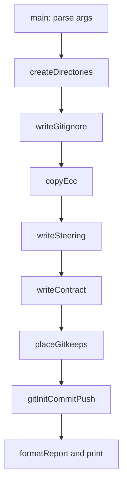

# Design Document

## Overview

The Bootstrap_Script is a single Node.js/TypeScript CLI (`scripts/bootstrap.ts`, run with `npx tsx scripts/bootstrap.ts [--remote <url>] [--ecc <path-or-url>]`). It scaffolds the team repository in the Workspace_Root `/Users/zabat0212/Desktop/hackathon`.

Fixed inputs from the original request:

- Folder names: `src/agent`, `src/data`, `src/components`, `src/types`. The three Role_Folders from the requirements map as agent = `src/agent`, data = `src/data`, UI = `src/components`. `src/types` holds the Contract_File.
- ECC_Source: `https://github.com/affaan-m/ECC.git`.
- Default remote URL: `https://github.com/zabat0212-codificador/agente-cdmx-kiro.git`. It can be overridden with `--remote`. Passing `--no-remote` skips the push (Requirement 7.7).

Design principles:

- Every step is idempotent and write-if-absent. Existing files are never overwritten.
- Every step returns a `StepResult`. A failing step never aborts the run. All results go to the Bootstrap_Report.
- Pure logic (gitignore merge, report formatting, gitkeep decision) is separated from I/O so it can be property-tested.

## Architecture



Steps run in this order. `placeGitkeeps` runs after all file-producing steps so that Requirement 6 is evaluated on the final folder contents. `gitInitCommitPush` runs last, so the initial commit contains every scaffolded file.

## Components and Interfaces

All code is TypeScript. File layout of the script:

```
scripts/
  bootstrap.ts        # main + step orchestration
  lib/
    fsx.ts            # writeIfAbsent, ensureDir, copyTreeNoOverwrite
    gitignore.ts      # mergeGitignore (pure)
    gitkeep.ts        # needsGitkeep (pure)
    report.ts         # formatReport (pure)
    templates.ts      # STEERING_ES, CONTRACT_TS strings
    git.ts            # thin wrapper over child_process execFile
```

### Shared types

```ts
export type StepStatus = "succeeded" | "skipped" | "failed";

export interface StepResult {
  step: string;          // e.g. "create-directories"
  status: StepStatus;
  detail?: string;       // reason, error message, or manual command
}

export interface BootstrapOptions {
  root: string;          // Workspace_Root
  eccSource: string;     // path or URL, default https://github.com/affaan-m/ECC.git
  remoteUrl?: string;    // undefined => skip push
}

export const ROLE_FOLDERS = ["src/agent", "src/data", "src/components"] as const;
export const REQUIRED_DIRS = [...ROLE_FOLDERS, "src/types", ".kiro/steering"] as const;
export const REQUIRED_GITIGNORE = [
  "node_modules/", ".env", ".env.*", "dist/", "build/", ".DS_Store", "Thumbs.db",
] as const;
```

### File helpers (`fsx.ts`)

```ts
/** Writes content only if the path does not exist. Returns true when written. */
export function writeIfAbsent(path: string, content: string): boolean;

/** mkdir -p. Never touches existing contents. */
export function ensureDir(path: string): void;

/** Copies src tree into dest, skipping any file that already exists at dest. */
export function copyTreeNoOverwrite(src: string, dest: string): { copied: string[]; kept: string[] };
```

### Gitignore merge (`gitignore.ts`, pure)

```ts
/**
 * Returns existing content with each required entry appended if no line of
 * existing equals it (after trim). Existing lines are preserved in order.
 */
export function mergeGitignore(existing: string, required: readonly string[]): string;
```

### Gitkeep decision (`gitkeep.ts`, pure)

```ts
/** True iff the folder listing has no entries other than ".gitkeep". */
export function needsGitkeep(entries: readonly string[]): boolean;
```

`placeGitkeeps` lists each Role_Folder, removes `.gitkeep` when other files exist (a `.gitkeep` created by an earlier run), and creates it when the folder is empty. Both rules follow from "`.gitkeep` is present iff there is no other entry". Only `.gitkeep` files that the script itself created are removed, and only when the folder has other files.

### ECC copy

`copyEcc(opts)`:

1. If `eccSource` is an existing local directory, use it directly. Otherwise treat it as a URL and run `git clone --depth 1 <url> <tmpdir>`.
2. Copy the `skills` and `agents` directories from the source into the Workspace_Root with `copyTreeNoOverwrite`. If the source stores them elsewhere (for example under `.kiro/`), the script searches for directories named `skills` and `agents` at the source root and one level down, and mirrors them under the same relative location in the Workspace_Root.
3. On a missing source, a clone failure, or no matching directories, return `failed` with the error message and continue.
4. Remove the temporary clone directory in a `finally` block.

### Templates

`CONTRACT_TS` (written to `src/types/contract.ts`):

```ts
// Fuente única de verdad para los tipos compartidos entre roles.
export interface AgentContract {
  id: string;
}

export interface DataContract {
  id: string;
}

export interface UiContract {
  id: string;
}
```

`STEERING_ES` (written to `.kiro/steering/protocolo-equipo.md`) is a Spanish Markdown document. It contains:

- A statement that `src/types/contract.ts` es la única fuente de verdad para los tipos compartidos entre roles, and that changes to it are announced to the team before merging.
- Responsibilities: rol agente (`src/agent`), rol datos (`src/data`), rol UI (`src/components`).
- Basic rules: work only in your own folder, integrate only through the contract types, and use small commits to `main` or short-lived branches.

### Git step (`git.ts` and `gitInitCommitPush`)

```ts
export function git(root: string, args: string[]): { ok: boolean; stdout: string; stderr: string };
```

Sequence:

1. If `.git` is absent: `git init -b main`. Result `succeeded`; otherwise `skipped` ("repository already exists").
2. `git add -A`, then `git commit -m "chore: bootstrap hackathon team repository"`. If nothing is staged, the commit step is `skipped`. When the repository already existed, a commit is created only if there are staged changes.
3. If `remoteUrl` is set: add `origin` with `git remote add origin <url>`, or `git remote set-url origin <url>` if `origin` exists. Then `git push -u origin main`.
4. If the push exits non-zero, return `failed` with detail `git push -u origin main` (the manual command) plus stderr. The local commit stays.
5. If `remoteUrl` is undefined, return `skipped` for the push with detail "no remote URL provided".

All git calls use `execFile` with an argument array, never a shell string, so the remote URL cannot inject shell commands. Credentials are never logged or stored in the script; the URL is used as given and the user's existing Git credential helper handles authentication.

### Report (`report.ts`, pure)

```ts
export function formatReport(results: readonly StepResult[]): string;
```

Output has one line per result: `[OK|SKIP|FAIL] <step> - <detail>`, followed by a totals line. `main` prints it and exits with code 0 even when steps failed, because failures are reported and recoverable. It exits with code 1 only for unexpected exceptions outside any step.

## Data Models

| Model | Fields | Notes |
|---|---|---|
| `StepResult` | `step`, `status`, `detail?` | One per step; the report is a list of these |
| `BootstrapOptions` | `root`, `eccSource`, `remoteUrl?` | Built from CLI args and the fixed defaults |
| Gitignore entry list | `string[]` | `REQUIRED_GITIGNORE`, compared by trimmed line equality |

## Error Handling

| Condition | Behavior | Requirement |
|---|---|---|
| Directory already exists | `ensureDir` is a no-op; contents untouched | 1.4 |
| File to write already exists | `writeIfAbsent` returns false; step reports `skipped` | 3.3, 4.5, 5.5, 8.2 |
| Existing `.gitignore` | Merge appends only missing entries | 2.3 |
| ECC source missing, clone fails, or copy throws | Step `failed` with message; later steps run | 3.2 |
| `git` not installed | Git step `failed` with message; local files remain | 7.6 |
| Push fails (no credentials, nonexistent remote) | `failed` with manual command; commit stays | 7.6 |
| No remote URL | Push `skipped` | 7.7 |
| Exception inside any step | Caught per step, converted to `failed` | 8.1 |

## Correctness Properties

*A property is a characteristic or behavior that should hold true across all valid executions of a system-essentially, a formal statement about what the system should do. Properties serve as the bridge between human-readable specifications and machine-verifiable correctness guarantees.*

### Property 1: Required directories exist after any run

For any initial state of the Workspace_Root (any subset of the required directories already present), after the directory step runs, `src/agent`, `src/data`, `src/components` and `src/types` all exist.

**Validates: Requirements 1.1, 1.2**

### Property 2: Existing files are never overwritten

For any initial Workspace_Root containing arbitrary files, including pre-existing `.gitignore` (outside the merge rule), `protocolo-equipo.md`, `contract.ts`, ECC destination files and files inside required directories, after a run every pre-existing file still has its original content, and every pre-existing directory still contains its original files.

**Validates: Requirements 1.4, 3.3, 4.5, 5.5, 8.2**

### Property 3: Gitignore merge preserves existing and adds required entries

For any existing `.gitignore` content and any list of required entries, `mergeGitignore` returns text that (a) contains every original line in its original order, (b) contains every required entry, and (c) contains no required entry more than once beyond the occurrences already in the original.

**Validates: Requirements 2.2, 2.3**

### Property 4: Gitignore merge is idempotent

For any existing `.gitignore` content, `mergeGitignore(mergeGitignore(x, R), R)` equals `mergeGitignore(x, R)`.

**Validates: Requirements 2.3, 8.2**

### Property 5: ECC copy reproduces the source tree without overwriting

For any source tree and any destination tree, after `copyTreeNoOverwrite` every source file exists at the destination, files that were already at the destination keep their content, and files that were absent have the source content.

**Validates: Requirements 3.1, 3.3**

### Property 6: Gitkeep present if and only if the folder has no other files

For any content of a Role_Folder (empty, only `.gitkeep`, or any set of files with or without `.gitkeep`), after `placeGitkeeps` the folder contains `.gitkeep` exactly when it contains no other file.

**Validates: Requirements 6.1, 6.2**

### Property 7: Report lists every step with its status

For any list of `StepResult` values, `formatReport` output contains, for each result, the step name and a marker matching its status (succeeded, skipped or failed).

**Validates: Requirements 8.1**

### Property 8: Running twice yields the same file tree

For any initial Workspace_Root state, the file tree (paths and contents, excluding `.git`) after the second run equals the tree after the first run.

**Validates: Requirements 8.2**

## Testing Strategy

Test framework: Vitest with fast-check for properties. Each property test runs at least 100 iterations and carries the tag `Feature: hackathon-team-bootstrap, Property N: <title>`. File-system properties (1, 2, 5, 6, 8) run against a fresh temporary directory per iteration, with generators for random file names, contents and subsets of existing directories. The ECC network clone is replaced by a local fixture directory for property tests.

Example-based unit tests:

- `.kiro/steering` exists after a run (1.3) and `.gitignore` exists on an empty root (2.1).
- The steering template contains the `src/types/contract.ts` source-of-truth statement and mentions the three role folders (4.1, 4.2, 4.3).
- The contract template exports three interfaces (5.2) and compiles with `tsc --noEmit` (5.1, 5.4).
- A nonexistent ECC source gives a `failed` result and later steps still run (3.2).
- An unreachable remote gives `failed` with the manual push command, and the local commit exists (7.6).
- Running without a remote gives a `skipped` push (7.7).

Integration tests, using a temporary directory and a local bare Git repository as the remote, with 1 to 3 examples each:

- Git is initialized with branch `main` (7.1, 7.2).
- The initial commit contains all scaffolded files (7.3).
- `origin` is configured and `main` arrives in the bare repository (7.4, 7.5).

Manual review: the steering file is written in Spanish (4.4) and the contract placeholders are minimal (5.3).
