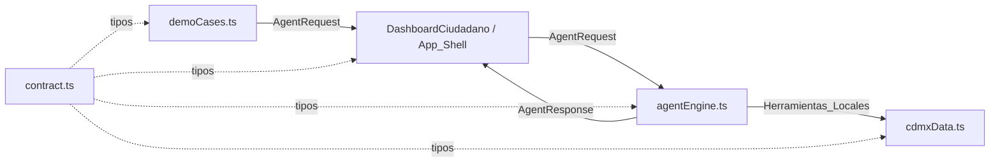

# Design Document

## Overview

TrámiBot CDMX es una SPA en Vite + React + TypeScript + TailwindCSS. Todo el procesamiento ocurre en el navegador: el `AgentEngine` normaliza la consulta, identifica el trámite en `CdmxData` mediante Herramientas_Locales y devuelve un `AgentResponse`. No hay LLM ni llamadas de red.

Decisiones principales:

- **Contrato único**: `src/types/contract.ts` es la fuente de verdad. Ningún módulo define tipos propios equivalentes.
- **Motor puro y síncrono en su núcleo**: `procesarConsulta(request): AgentResponse` no tiene efectos secundarios, lo que permite pruebas de propiedades.
- **Coincidencia por diccionario de sinónimos**: cada trámite lleva palabras clave y variantes coloquiales/errores de dedo ya normalizadas. Se puntúa por coincidencias. Se descarta fuzzy matching genérico por ser menos predecible en la demo.
- **UI sin estado global**: `useState` en `DashboardCiudadano`.

Supuesto: `AgentResponse` tiene exactamente los campos definidos en requirements.md. `costoOficialMXN` es un `string` listo para mostrar (por ejemplo `"$1,234.00 MXN"` o `"Gratuito"`), igual que `tiempoResolucion`, `fundamentoNormativo`, `alertaAnticorrupcion` y `ubicacionModuloAlcaldia`. `impactoComunitario` es `{ poblacionObjetivo: string; ahorroEstimado: string }`. `CdmxData` guarda el costo como número (`costoMXN`) y el `AgentEngine` lo formatea a texto con `formatearCosto`.

## Architecture



Estructura de archivos:

```
src/types/contract.ts
src/data/cdmxData.ts
src/data/demoCases.ts
src/agent/agentEngine.ts
src/components/DashboardCiudadano.tsx
src/App.tsx, src/main.tsx, index.html, tailwind.config.*, vite.config.ts
```

## Components and Interfaces

### Contract (`src/types/contract.ts`)

Se conservan las tres interfaces existentes y se agregan los tipos nuevos.

```typescript
export interface AgentContract { id: string; }
export interface DataContract { id: string; }
export interface UiContract { id: string; }

export type AlcaldiaCDMX =
  | 'Álvaro Obregón' | 'Azcapotzalco' | 'Benito Juárez' | 'Coyoacán'
  | 'Cuajimalpa de Morelos' | 'Cuauhtémoc' | 'Gustavo A. Madero' | 'Iztacalco'
  | 'Iztapalapa' | 'La Magdalena Contreras' | 'Miguel Hidalgo' | 'Milpa Alta'
  | 'Tláhuac' | 'Tlalpan' | 'Venustiano Carranza' | 'Xochimilco';

export type CategoriaTramite =
  | 'Negocios y Comercio (SIAPEM)'
  | 'Movilidad y Vehículos (SEMOVI)'
  | 'Vivienda y Uso de Suelo (SEDUVI)'
  | 'Identidad y Registro Civil'
  | 'Atención Ciudadana (SUAC)';

export interface AgentRequest {
  id: string;
  consultaCiudadana: string;
  alcaldia: AlcaldiaCDMX;
  categoria?: CategoriaTramite;
}

export interface AgentResponse {
  id: string;
  nombreTramite: string;
  dependencia: string;
  requiereLlaveCDMX: boolean;
  modalidad: '100% Digital' | 'Híbrido' | 'Presencial';
  resumenCiudadano: string;
  pasosAccion: string[];
  documentosRequeridos: string[];
  costoOficialMXN: string; // p. ej. "$1,234.00 MXN" o "Gratuito"
  tiempoResolucion: string;
  fundamentoNormativo: string;
  alertaAnticorrupcion: string;
  ubicacionModuloAlcaldia: string;
  impactoComunitario: { poblacionObjetivo: string; ahorroEstimado: string };
}
```

### CdmxData (`src/data/cdmxData.ts`, Rol 2)

```typescript
import type { AlcaldiaCDMX, CategoriaTramite, AgentResponse } from '../types/contract';

export interface TramiteRecord {
  id: string;
  nombreTramite: string;
  categoria: CategoriaTramite;
  dependencia: string;
  requiereLlaveCDMX: boolean;
  modalidad: AgentResponse['modalidad'];
  resumenCiudadano: string;
  pasosAccion: string[];
  documentosRequeridos: string[];
  costoMXN: number; // valor numérico interno (0 = gratuito); el engine lo formatea a string
  tiempoResolucion: string;
  fundamentoNormativo: string;
  alertaAnticorrupcion: string;
  impactoComunitario: AgentResponse['impactoComunitario'];
  palabrasClave: string[]; // ya normalizadas: sin acentos, minúsculas
}

export const TRAMITES: TramiteRecord[];
export const MODULOS_ALCALDIA: Record<AlcaldiaCDMX, string>;
export const ALCALDIAS: AlcaldiaCDMX[]; // las 16, en orden alfabético
export const CATEGORIAS: CategoriaTramite[]; // las 5
```

Trámites incluidos: apertura de negocio de bajo impacto (SIAPEM), Licencia Tipo A, Tarjeta de Circulación, Certificado Único de Zonificación de Uso de Suelo, actas certificadas del Registro Civil y Reporte SUAC/Locatel. Los costos y el fundamento normativo se capturan de fuentes oficiales al construir los datos.

### AgentEngine (`src/agent/agentEngine.ts`, Rol 1)

```typescript
import type { AgentRequest, AgentResponse } from '../types/contract';

export function normalizar(texto: string): string;
export function buscarTramite(consultaNorm: string, categoria?: CategoriaTramite): TramiteRecord | null;
export function obtenerUbicacion(alcaldia: AlcaldiaCDMX): string;
/** 0 -> "Gratuito"; otro valor -> "$1,234.00 MXN" (separador de miles y 2 decimales). */
export function formatearCosto(costoMXN: number): string;
export function procesarConsulta(req: AgentRequest): AgentResponse;
```

Algoritmo de `procesarConsulta`:

1. `consultaNorm = normalizar(req.consultaCiudadana)`.
2. `candidatos = TRAMITES` filtrados por `req.categoria` si existe.
3. Se puntúa cada candidato por número de `palabrasClave` contenidas en `consultaNorm`. Gana la mayor puntuación (mayor a 0). Un empate se resuelve por el orden de `TRAMITES`.
4. Sin ganador: devuelve una respuesta de "no encontrado" (ver Error Handling).
5. Con ganador: construye el `AgentResponse` con `id: req.id`, `costoOficialMXN: formatearCosto(tramite.costoMXN)` y `ubicacionModuloAlcaldia: MODULOS_ALCALDIA[req.alcaldia]`.

`normalizar`: `toLowerCase()`, `normalize('NFD')`, eliminación de `\p{Diacritic}`, reemplazo de caracteres que no sean letras/dígitos por espacio, colapso de espacios y `trim()`. La función es idempotente. Los errores de dedo y coloquialismos (por ejemplo "chamba", "taqueria", "clausuren", "licensia") se cubren con variantes en `palabrasClave`.

Sólo importa de `cdmxData` y `contract`. No usa `fetch`, `XMLHttpRequest` ni SDKs externos.

### DemoCases (`src/data/demoCases.ts`, Rol 4)

```typescript
export interface DemoCase { etiqueta: string; request: AgentRequest; }
export const DEMO_CASES: DemoCase[]; // exactamente 3
```

El primer caso es "quiero abrir una cafetería y que no me clausuren" en una alcaldía fija. Los otros dos cubren otras categorías (por ejemplo licencia de conducir y acta de nacimiento).

### DashboardCiudadano (`src/components/DashboardCiudadano.tsx`, Rol 3)

```typescript
export function DashboardCiudadano(): JSX.Element;
```

Estado local:

| Estado | Tipo |
|---|---|
| `alcaldia` | `AlcaldiaCDMX` |
| `mensajes` | `{ autor: 'ciudadano' \| 'bot'; texto: string }[]` |
| `respuesta` | `AgentResponse \| null` |
| `marcados` | `Set<string>` (documentos marcados) |

Subcomponentes internos: `SelectorAlcaldia`, `BotonesDemo`, `Chat`, `ChecklistDocumentos`, `DistintivoLlave`, `TarjetaCosto`, `DetalleTramite`.

Flujo: al enviar el chat o pulsar un caso demo, se arma el `AgentRequest` (id generado con `crypto.randomUUID()` o contador), se llama a `procesarConsulta`, se agrega `resumenCiudadano` al chat, se guarda `respuesta` y se reinicia `marcados`. El distintivo "Llave CDMX" se renderiza sólo si `requiereLlaveCDMX` es verdadero. La tarjeta de costo muestra el texto `costoOficialMXN` tal como llega (ya formateado) junto con `alertaAnticorrupcion`.

Accesibilidad: `<label>` asociado a cada control, `aria-live="polite"` en el chat, checkboxes nativos, foco visible con clases Tailwind (`focus-visible:ring`), contraste mínimo 4.5:1. Todos los textos están en español.

### App_Shell (`src/App.tsx`)

Renderiza `<DashboardCiudadano />`. `main.tsx` monta `App` en `#root`.

## Data Models

- `AgentRequest` y `AgentResponse`: ver Contract.
- `TramiteRecord`: registro interno de `CdmxData`. Se proyecta a `AgentResponse` agregando `id` y `ubicacionModuloAlcaldia`, convirtiendo `costoMXN` (number) en `costoOficialMXN` (string) con `formatearCosto`, y omitiendo `categoria` y `palabrasClave`.
- `MODULOS_ALCALDIA`: `Record<AlcaldiaCDMX, string>` obliga en compilación a tener las 16 entradas.

## Error Handling

| Situación | Comportamiento |
|---|---|
| Consulta sin coincidencia | `AgentResponse` con `nombreTramite: 'Trámite no encontrado'`, `resumenCiudadano` que indica que no se encontró y sugiere reformular, arreglos vacíos, `costoOficialMXN: 'No disponible'`, `requiereLlaveCDMX: false`, `modalidad: 'Presencial'`, ubicación de la alcaldía y mismo `id`. |
| Consulta vacía o sólo espacios | Se trata como sin coincidencia. El chat no envía mensajes vacíos y deshabilita el botón. |
| Categoría sin trámites coincidentes | Sin coincidencia, igual que arriba. |
| Alcaldía inexistente en runtime | `obtenerUbicacion` devuelve un texto genérico y no lanza excepción. |

`procesarConsulta` nunca lanza excepciones para entradas de tipo válido.

## Testing Strategy

Se usa Vitest (ya configurado) con `fast-check` para propiedades (mínimo 100 iteraciones) y React Testing Library para la UI. Cada prueba de propiedad lleva la etiqueta `Feature: tramibot-cdmx, Property N: <texto>`.

- **Pruebas de propiedades**: Propiedades 1 a 12. Los generadores de `AgentResponse` producen `costoOficialMXN` como `string`.
- **Pruebas de ejemplo**: consulta de la cafetería (3.3), existencia de los trámites (2.1), 3 escenarios de demo (4.1), clic en demo (4.2), selector con 16 alcaldías (5.1), accesibilidad básica (5.8).
- **Smoke**: `tsc --noEmit` verifica el contrato (Requisito 1) y el tipado de datos; una prueba revisa que `src/agent` no contenga `fetch` ni imports de red (3.7); `npm run dev` arranca (6.1).
- El commit y push (Requisito 7) es un paso manual de cierre, sin prueba automatizada.

## Correctness Properties

*A property is a characteristic or behavior that should hold true across all valid executions of a system-essentially, a formal statement about what the system should do. Properties serve as the bridge between human-readable specifications and machine-verifiable correctness guarantees.*

### Property 1: Todo trámite tiene categoría válida

For any trámite en `TRAMITES`, su `categoria` pertenece a las cinco `CategoriaTramite` definidas.

**Validates: Requirements 2.2**

### Property 2: Todo trámite tiene datos completos y válidos

For any trámite en `TRAMITES`, `costoMXN` es un número finito mayor o igual a 0, `pasosAccion` y `documentosRequeridos` no están vacíos, `fundamentoNormativo` y `tiempoResolucion` son cadenas no vacías y `modalidad` es uno de los tres valores permitidos.

**Validates: Requirements 2.3**

### Property 3: Toda alcaldía tiene módulo de atención

For any `AlcaldiaCDMX`, `MODULOS_ALCALDIA` contiene una dirección no vacía.

**Validates: Requirements 2.4**

### Property 4: Normalización correcta e idempotente

For any cadena de texto, `normalizar` produce un resultado sin mayúsculas, sin marcas diacríticas, sin espacios consecutivos ni al inicio o final, y `normalizar(normalizar(s))` es igual a `normalizar(s)`.

**Validates: Requirements 3.1**

### Property 5: Variantes coloquiales resuelven al trámite

For any trámite y cualquier palabra clave (incluidos sinónimos y errores de dedo) de su lista, una consulta que la contenga, con cualquier capitalización y acentuación, es resuelta a ese trámite cuando no hay otra coincidencia de mayor puntuación.

**Validates: Requirements 3.2**

### Property 6: La categoría restringe el trámite

For any `AgentRequest` con `categoria` definida cuyo resultado sea un trámite encontrado, ese trámite pertenece a `categoria`.

**Validates: Requirements 3.4**

### Property 7: La respuesta conserva el id y la ubicación de la alcaldía

For any `AgentRequest` válido, `procesarConsulta` devuelve un `AgentResponse` con el mismo `id` y con `ubicacionModuloAlcaldia` igual a `MODULOS_ALCALDIA[req.alcaldia]`.

**Validates: Requirements 3.5**

### Property 8: Consultas sin coincidencia sugieren reformular

For any consulta formada sólo por palabras que no figuran en ninguna `palabrasClave`, `procesarConsulta` no lanza excepción y devuelve un `resumenCiudadano` que indica que no se encontró el trámite y sugiere reformular.

**Validates: Requirements 3.6**

### Property 9: Marcar dos veces un documento restaura el estado

For any `AgentResponse` y cualquier documento de `documentosRequeridos`, alternar su casilla dos veces deja el conjunto de marcados como estaba, y alternarla una vez cambia sólo ese documento.

**Validates: Requirements 5.4**

### Property 10: El distintivo Llave CDMX refleja el campo

For any `AgentResponse`, el distintivo "Llave CDMX" aparece en la interfaz si y sólo si `requiereLlaveCDMX` es verdadero.

**Validates: Requirements 5.5**

### Property 11: La interfaz muestra todos los campos de la respuesta

For any `AgentResponse` (con `costoOficialMXN` de tipo `string`), el contenido renderizado incluye el texto de `costoOficialMXN` sin alterarlo, `alertaAnticorrupcion`, todos los `pasosAccion`, `tiempoResolucion`, `fundamentoNormativo`, `ubicacionModuloAlcaldia` y los datos de `impactoComunitario`.

**Validates: Requirements 5.6, 5.7**

### Property 12: El costo se formatea como texto MXN

For any número finito `n >= 0`, `formatearCosto(n)` devuelve un `string`: `"Gratuito"` si `n` es 0, y en otro caso un texto que coincide con `^\$\d{1,3}(,\d{3})*\.\d{2} MXN$` y cuyo valor numérico, al quitar `$`, `,` y ` MXN`, es igual a `n` redondeado a 2 decimales. Además, for any trámite en `TRAMITES` y cualquier `AgentRequest` que lo identifique, `procesarConsulta(req).costoOficialMXN` es igual a `formatearCosto(tramite.costoMXN)` y es de tipo `string`.

**Validates: Requirements 1.5, 2.3, 3.5, 5.6**
